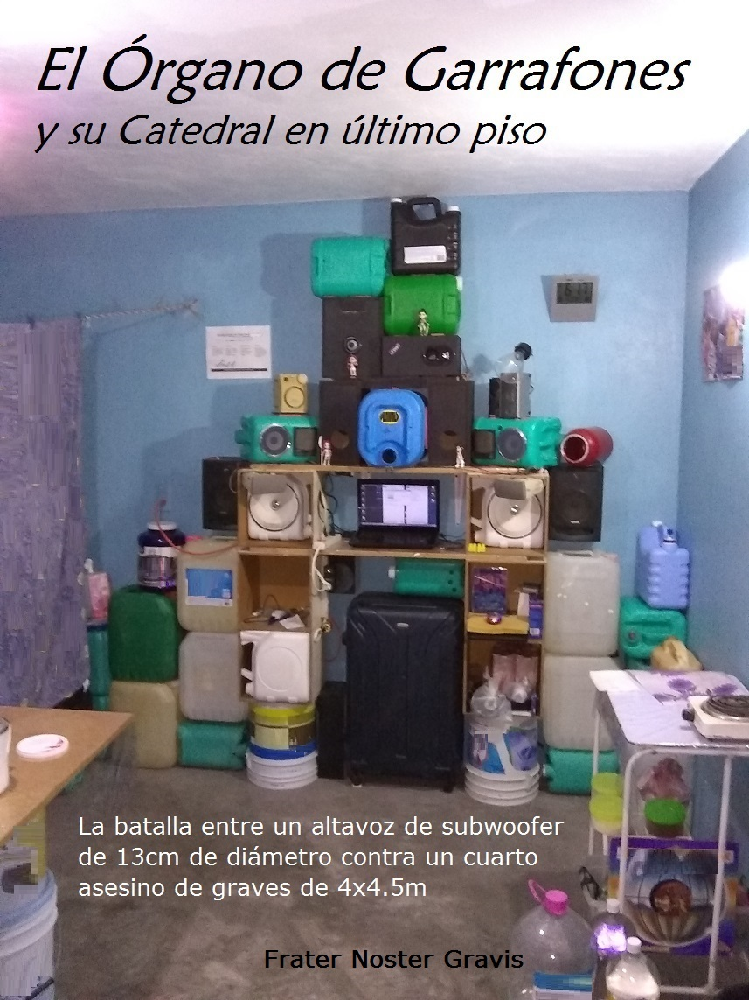

The complete PDF book is already available FREE in English at the links below:
https://archive.org/details/the-water-jug-organ-frater-noster-2026   
https://zenodo.org/records/24168128
https://github.com/frater-noster-gravis/water-jug-organ  
https://independent.academia.edu/FraterNosterGravis
https://commons.wikimedia.org/wiki/File:The-Water-Jug-Organ-Frater-Noster.pdf  

	En algún lugar del mundo existe un órgano hecho en casa, en lo más alto de un edificio, haciendo que audios muy comprimidos suenen a disco de vinil usando solo resonancia natural y resalte de armónicos analógico; sin efectos digitales, solo con aire y un poco de agua. 
	Un órgano de iglesia usa todo el espacio de la nave como su instrumento. El Órgano de Garrafones y su Catedral en último piso hacen lo mismo. Mismos principios de física, en diferente siglo.

Libro completo PDF version en español GRATIS disponible AQUÍ y en:
https://archive.org/details/el-organo-de-garrafones-frater-noster-2026
https://doi.org/10.5281/zenodo.23350980
https://independent.academia.edu/FraterNosterGravis
https://works.hcommons.org/records/cf7mj-vys94#description-heading
https://commons.wikimedia.org/wiki/File:El_%C3%93rgano_de_Garrafones_y_su_Catedral_en_%C3%BAltimo_piso.pdf
