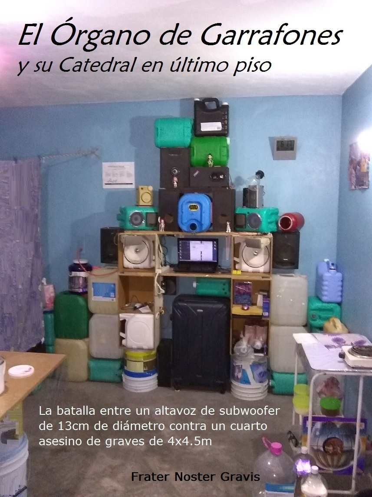

El Órgano de Garrafones y su Catedral en último piso

Frater Noster Gravis

Primera y única edición. Octubre, 2026.

México.

La batalla entre un altavoz de subwoofer de 13cm de diámetro contra un cuarto asesino de graves de 4x4.5m en el último piso de un edificio.

Órgano de Garrafones + Catedral / Potenciador de Fidelidad: Sistema de sonido que opera conjugando los principios del piano de cola, el órgano de iglesia, la matriz acoplada de resonadores Helmholtz y TLD's antisísmicos que transforman vibración de ruido estructural en vibración auditiva musical con resalte de armónicos para reproducción de audio digital comprimido acústicamente enriquecido por resonancia natural.

Se describe prototipo funcional con fotografías y datos técnicos, pruebas realizadas y detalles sobre uso de equipos. El autor no se hace responsable por daños, lesiones o perjuicios derivados de la replicación parcial o total de este sistema.

Documento bajo licencia CC BY-SA 4.0.

Link para descarga de PDF:
[Click aquí para descargar el PDF](libro.pdf)

Archive.org link PDF: https://archive.org/details/el-organo-de-garrafones-frater-noster-2026

